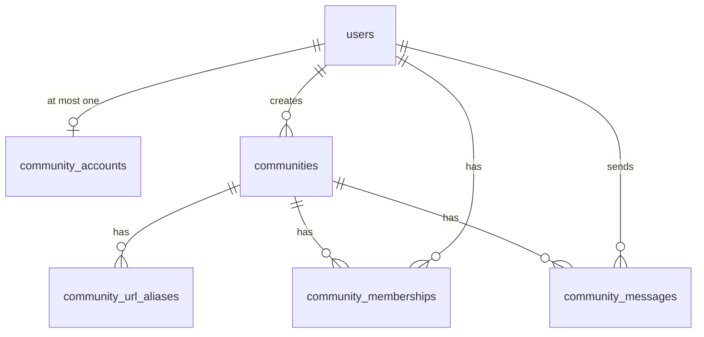

# Community persistence

Community data lives in MySQL, mapped by JPA, under `com.developer.copilot.community`. The application still updates the schema with `spring.jpa.hibernate.ddl-auto` (typically `update`). This module does not add Flyway or Liquibase.

There is no controller or service yet. The tables exist so later tasks can add consent, URL matching, join, and text history without redesigning the keys.

## Responsibilities

| Module | Owns | Does not own |
| --- | --- | --- |
| auth | `users`, JWT, `CurrentUserService` identity | Community rows |
| jobs | A user’s saved posting (`jobs`) | Which people share a discussion |
| community | Account opt-in, the group, URL aliases, membership, messages | A second user record, a copy of a job, chat delivery |

A community is the real-world posting. `jobs.id` is only how the signed-in user points at their own row. Two users can have different job ids for one posting and must still land in one community.

## Relationships

Every association is lazy. Child rows point at the parent. Nothing maps a collection back, so a load does not pull every message or every member.

All five entities extend `BaseEntity` (`created_at` not null, `updated_at` nullable), filled by the existing `@EnableJpaAuditing` setup. Primary keys are `Long` identity columns, same as `users` and `jobs`.

## Tables

### `community_accounts`

One opt-in row per user. Columns: `id`, unique `user_id` → `users.id`, `accepted_terms_version` (`VARCHAR(64)` not null), `terms_accepted_at` (not null), audit timestamps.

Unique: `uk_community_account_user` on `user_id`.

Username, full name, email, and password stay on `users`. The stored terms version is the one the user accepted. Comparing it with a future current version is how re-acceptance is required. That current version is not a column yet.

### `communities`

Columns:

| Column | Role |
| --- | --- |
| `id` | Group id |
| `canonical_posting_key` | Immutable `VARCHAR(64)` SHA-256 hex of the canonical normalized posting URL. Unique (`uk_community_canonical_posting_key`). Not `jobs.id` |
| `community_name` | Immutable generated name, `VARCHAR(255)`, unique (`uk_community_name`) |
| `title`, `company` | Shared header, `VARCHAR(255)`, not null |
| `location` | Shared header, `VARCHAR(255)`, nullable |
| `description` | Shared or refined description, `TEXT`, not null |
| `created_by_user_id` | Creator, → `users.id`, immutable |

No salary column. The context notes do not require salary, and the creation form does not list it. No status or expiry column. Communities are not deleted. A later lifecycle can add a column here.

Title and company are not identity. They must not merge two postings by themselves.

### `community_url_aliases`

Many aliases, one community. Columns: `community_id` → `communities.id`, optional `original_url` (`VARCHAR(2000)`), `normalized_url` (`VARCHAR(2000)` not null), `normalized_url_hash` (`VARCHAR(64)` not null, immutable).

Unique: `uk_community_url_alias_hash` on `normalized_url_hash`. The hash exists for the same reason as `jobs.source_url_hash`: InnoDB cannot uniquely index the long URL. Index: `idx_community_url_alias_community` on `community_id`.

The canonical URL is also an alias, and its hash is `canonical_posting_key`. Other recognized URLs are further aliases. One hash cannot belong to two communities.

`original_url` is only for a submitted link that is safe to keep. Do not store userinfo, access tokens, or raw tracking parameters. Null is allowed.

Matching itself is not in this module yet. The place for it is `com.developer.copilot.community.service.matching`, reusing `UrlNormalizationUtil` (`normalizeStrict` / `sha256Hex`) where those rules are safe. That package is not created until it has code.

### `community_memberships`

One row per user per community. Columns: `community_id`, `user_id` → `users.id`, `membership_status` (`ACTIVE` or `LEFT`), `joined_at` (not null), `left_at` (nullable only while active).

Unique: `uk_community_membership_community_user` on `(community_id, user_id)`. That is the active-membership rule. A racing second join cannot insert another row. Rejoin updates this row to `ACTIVE` and clears `left_at`. Leave sets `LEFT` and `left_at` and does not delete messages or the community.

Check: `ck_community_membership_status_left_at` requires `left_at` to be null exactly when status is `ACTIVE`.

Indexes: `idx_community_membership_user_status` `(user_id, membership_status)` and `idx_community_membership_community_status` `(community_id, membership_status)` for “my communities” and member counts.

The member foreign key is `users.id`, matching jobs and messages. It does not copy the profile. The account row is what records consent.

### `community_messages`

Columns: `community_id`, `sender_user_id` → `users.id`, `content` (`TEXT` not null), audit timestamps.

Index: `idx_community_message_history` on `(community_id, created_at, id)`.

History is newest first. The next page is strictly older than the cursor `(created_at, id)`. `CommunityMessageRepository.findOlderThan` is that query. The page request must set a limit and must not add its own sort.

## Concurrency

Do not use check-then-insert as the only guard. The unique keys above are the guards. Community creation (row + canonical key + aliases + creator membership) has to be one transaction in the creation task. An uncaught integrity error still becomes the existing generic HTTP 409 from `GlobalExceptionHandler`. Later services should map these constraint names to a specific response before that, and must not put SQL in the API body.

## Inspection notes

- **User primary key:** `users.id`, `Long`, identity. Loaded from the JWT by `JwtAuthenticationFilter`, then read through `CurrentUserService`.
- **Job ownership:** `JobRepository.findByIdAndUserId`. Community tables do not reference `jobs`.
- **AI:** `AiService` / `AiServiceImpl` and Spring AI `ChatClient`. Not called here. `extractJobInfo` and `chat` both pull resume context, so description refinement needs its own call that sends only the permitted description.
- **WebSocket:** none in the repo. Redis is optional rate-limit and cache storage, not messaging. No Redis usage was added.
- **Migrations:** Hibernate `ddl-auto` only. No new configuration keys.
- **Privacy:** no email, password, phone, resume, notes, or full job copy in these tables. Later APIs return DTOs, not entities.

Column-level detail for this task is also in `documentation/subscription2/community/prompts/task1/database.md`.
